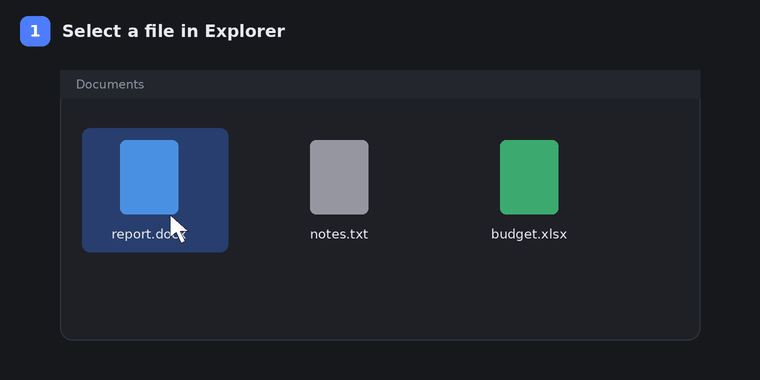
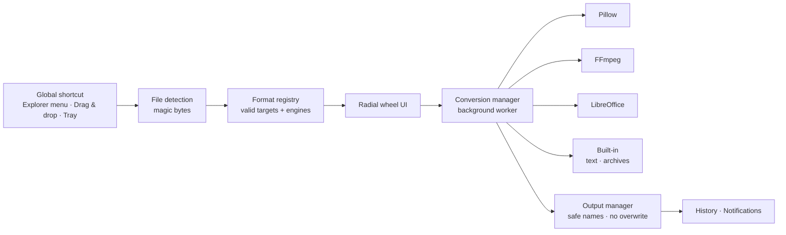

<div align="center">


<br/>


-41CD52?logo=qt&logoColor=white)


**Select a file. Press `Ctrl + Alt + Right-click`. Pick a format on the wheel. Done.**

</div>

---

## ✨ What is conWheel?

conWheel is a Windows desktop file converter built around one idea: **conversion should take one gesture, not a trip to a website.**
Select a file in Explorer, trigger the shortcut, and a radial menu appears at your cursor showing **only the formats that are valid for that file**.
Everything runs on your machine - no uploads, no accounts, no telemetry.

<div align="center">


<sub>Illustrative animation of the wheel (rendered by <code>tools_make_readme_assets.py</code>, not a screen capture).</sub>

</div>

## 🎬 How it works

<div align="center">

</div>

1. **Select** a file in Explorer (or drag it onto the window, or use *Convert with conWheel* in the right-click menu).
2. **Trigger** the wheel with the global shortcut (default `Ctrl + Alt + Right-click`, configurable).
3. **Choose** a format with the mouse, scroll wheel, arrow keys or Enter. `Esc` / right-click cancels or goes back.
4. conWheel validates the file, converts it in a **background worker**, and saves `Name_converted.ext` - never overwriting an existing file.

## 🚀 Features

| | |
|---|---|
| 🎡 **Radial wheel** | Frameless translucent Qt window, hover highlight, entrance animation, edge-aware positioning, categories and a "More…" segment when there are many formats |
| 🧠 **Content-based detection** | Identifies files by their bytes (magic numbers), not just the extension - and warns on mismatch |
| ✅ **Only valid options** | A conversion registry offers a format only if the source type *and* the required engine are available |
| 🧵 **Never freezes** | Heavy work runs off the GUI thread; progress, cancellation and timeouts for FFmpeg / LibreOffice |
| 📦 **Batch queue** | Per-file target format, reorder/remove, pause/resume/cancel, success/failure summary |
| 🛡️ **Safe by default** | No shell strings (argv lists only), filename sanitising, Windows reserved names, archive path-traversal & symlink blocking, temp-dir cleanup |
| 🔒 **Private** | Local-only processing; history stores names and paths, **never file contents** |
| 🧩 **Plugin-friendly** | Add a converter by exposing `conversions_for(fmt)` and calling `register_plugin()` |
| 🖥️ **Windows integration** | Tray icon, optional launch-at-login, optional Explorer context-menu entry (per-user, no admin rights) |

## 🔄 Supported conversions

| Category | Formats | Engine |
|---|---|---|
| 🖼️ Images | PNG · JPG · WebP · BMP · TIFF · GIF · ICO (any → any) | Pillow |
| 🎵 Audio | MP3 · WAV · FLAC · AAC · M4A · OGG · Opus (any → any) | FFmpeg |
| 🎬 Video | MP4 · MKV · MOV · AVI · WebM · GIF, plus audio extraction (MP3 / WAV / M4A) | FFmpeg |
| 📄 Documents | DOCX · DOC · ODT · RTF → PDF / DOCX / ODT / RTF / TXT / HTML; TXT → PDF / DOCX / ODT / RTF; HTML → PDF / DOCX / ODT | LibreOffice |
| 📊 Spreadsheets | XLSX · XLS · ODS → XLSX / ODS / CSV / PDF; CSV · TSV → XLSX / ODS / PDF | LibreOffice |
| 📽️ Presentations | PPTX · PPT · ODP → PDF / PPTX / ODP | LibreOffice |
| 🔤 Text & data | CSV ↔ TSV · CSV/TSV ↔ JSON · JSON ↔ XML · HTML → TXT · TXT → HTML · MD → TXT / HTML | built-in |
| 📑 PDF | PDF → TXT | PyMuPDF |
| 🗜️ Archives | ZIP ↔ TAR ↔ TGZ repackaging · GZ decompression · separate safe *extract* operation | built-in |

> **Honest by design:** PDF → DOCX is intentionally **not** offered because the original layout can't be reproduced reliably, and OCR isn't implemented.
> Lossy or lossless behaviour, dropped transparency, CSV losing sheets/formulas, etc. are surfaced as notes in the conversion dialog.

## 🧱 Architecture



```text
conWheel/
├── app/
│   ├── main.py · application.py · config.py · constants.py
│   ├── ui/            main_window · radial_wheel · wheel_geometry · batch_window · history_view · settings_window · conversion_dialog
│   ├── core/          file_detection · format_registry · conversion_manager · job_queue · output_manager · validation
│   ├── converters/    images · audio · video · documents · spreadsheets · presentations · text_data · archives · pdf
│   ├── integrations/  global_shortcut · shortcut_logic · explorer_integration · system_tray
│   └── resources/     icons · fonts
├── tests/             test_core.py (+ helpers)
├── installer/         conWheel.iss (Inno Setup)
├── assets/            README banner and animations
├── conWheel.spec · build_exe.bat · build_installer.bat · run_dev.bat · run_tests.bat
└── requirements.txt · pyproject.toml · LICENSES.md
```

## 📦 Installation

### Option A - run from source (recommended while the GUI is being verified)

```bat
git clone https://github.com/Kmrr-Gautam/conWheel.git
cd conWheel
run_dev.bat
```

`run_dev.bat` creates a `.venv`, installs `requirements.txt`, generates the icon and launches the app. Requires **Python 3.12+ (64-bit)**.

### Option B - build the executable and installer

```bat
build_exe.bat          :: -> dist\conWheel\conWheel.exe  (one-folder, windowed)
build_installer.bat    :: -> installer\Output\conWheel-Setup.exe  (needs Inno Setup 6)
```

The installer offers a Start Menu entry, an optional desktop shortcut, an optional Explorer right-click entry, optional start-in-tray at sign-in, and an uninstaller.

### External engines

| Engine | Needed for | Get it |
|---|---|---|
| FFmpeg + ffprobe | audio, video | [ffmpeg.org](https://ffmpeg.org) → add to `PATH`, or drop `ffmpeg.exe` / `ffprobe.exe` into `vendor\ffmpeg\` before building |
| LibreOffice | documents, spreadsheets, presentations | [libreoffice.org](https://www.libreoffice.org) (not bundled - too large) |

Missing engines are never hidden: **Settings → Engines** shows what's installed, and formats that need a missing engine simply aren't offered.

## ⌨️ Controls

| Input | Action |
|---|---|
| Mouse move | Highlight the closest segment |
| Left click | Choose the highlighted format (click the centre to cancel) |
| Mouse wheel / ← → ↑ ↓ | Rotate through formats |
| `Enter` | Confirm |
| `Esc` | Close the wheel |
| Right click / `Backspace` | Back to the previous ring, or cancel |

## 🔐 Privacy & security

- **Local only.** No uploads, no analytics, no network calls for normal conversions.
- **About the shortcut.** conWheel installs a low-level keyboard/mouse listener (via `pynput`) **only to check whether your chosen modifier keys (Ctrl / Alt / Shift / Win) are held when you click the chosen mouse button.** Other keystrokes are ignored - not stored, logged or sent anywhere. Disable it any time in *Settings → Shortcut* or from the tray menu; the hook is removed on exit.
- **No admin rights.** Registry entries (context menu, autostart) are written under the current user only.
- **Untrusted input.** Archives are checked for path traversal, symlinks/devices and absurd expansion sizes; files are never executed; subprocesses use argument lists, not shell strings.

## 🧪 Testing & project status

```bat
run_tests.bat
```

| Area | Status |
|---|---|
| Detection, registry, naming/sanitising, overwrite protection, Unicode paths | ✅ 48 automated tests passing (run on Linux with Python 3.12, FFmpeg 6.1 and LibreOffice 24.2) |
| Image / text / archive / audio / video / office conversions, cancel + temp cleanup, batch queue, settings & history, wheel geometry, shortcut matching | ✅ covered by those 48 tests |
| PySide6 GUI, radial wheel widget, tray, global hook, Explorer COM integration | 🟡 written, **not yet run on Windows** |
| `conWheel.exe` (PyInstaller) and `conWheel-Setup.exe` (Inno Setup) | 🟡 scripts provided, **not yet built** |
| PPTX/PPT/ODP conversions, PDF → TXT, TAR/GZ conversions, extract-archive helper | 🟡 implemented, not yet covered by automated tests |

The GIFs in this README are illustrative renders, **not screenshots** - replace them with real captures (e.g. ScreenToGif) once the app has been run on Windows.

## 🗺️ Roadmap

- [ ] Verify and polish the Qt UI on Windows 10/11 (DPI scaling, multi-monitor edge cases)
- [ ] Publish a signed `conWheel-Setup.exe` in GitHub Releases
- [ ] Optional OCR for scanned PDFs (Tesseract)
- [ ] Image resize controls in the conversion dialog
- [ ] Explorer selection for the Desktop and third-party file managers
- [ ] Windows 11 modern context-menu entry
- [ ] Real screenshots / screen recording for this README

## 🤝 Contributing

Issues and pull requests are welcome. To add a converter, create a module that exposes `conversions_for(fmt) -> list[Conversion]`
and register it with `app.core.format_registry.register_plugin(module)`. Please run `run_tests.bat` before opening a PR, and only report a conversion as working if you've actually run it.

## 📜 License

No license has been chosen yet - add a `LICENSE` file before publishing. Third-party components and their redistribution terms
(notably **PyMuPDF - AGPL**, **Qt/PySide6 - LGPL**, **FFmpeg - LGPL/GPL depending on build**) are listed in [`LICENSES.md`](LICENSES.md).

<div align="center">

<sub>Built with Python, Qt, FFmpeg, LibreOffice and Pillow · Regenerate the README art with <code>python tools_make_readme_assets.py</code></sub>

</div>
